<!--
SPDX-FileCopyrightText: 2026 OSH Dir Std Contributors
SPDX-FileCopyrightText: 2026 Benjamin Götze
SPDX-License-Identifier: GFDL-1.3-or-later
-->

# Designish - OSH project directory structure standards

In short: **Lifecycle-driven and designer-friendly**

The basic idea here is that directories are named after the *phase of the
design lifecycle* they belong to, rather than the file types they contain.
This makes the project's maturity and progress immediately visible to
contributors of all backgrounds — including designers with no prior Git
experience.

The structure follows a 5-phase creative pipeline inside `30_engineering/`,
preceded by management (`10_management/`) and legal (`20_legal/`) top-level
concerns.

## Definition

This standards machine-readable definition,
can be found in various formats here:

- [definition.csv](definition.csv)
  ([format](../../definition_format.md))
  \- source, machine-readable, contains all the data
  \- **use this for editing**
- [file-listing](
  https://osegermany.gitlab.io/osh-dir-std/mod/designish/listing.txt)
  \- like the output of `find` in a sample repo
  \- generated
- [tree](
  https://osegermany.gitlab.io/osh-dir-std/mod/designish/tree.html)
  \- like the output of `tree` in a sample repo
  \- generated, **recommended** for inspection

## Guiding principles & Inspirations

This standard is inspired by design studio workflows and product development
pipelines, where a contributor's first question is *"where are we in the
process?"* rather than *"what file type is this?"*

Key principles:

- **Phase visibility**: Numbered top-level phases (`10_`, `20_`, `30_`) and
  numbered sub-phases (`01_concept`, `02_design`, …) act as a visual
  progress map.
- **Designer-first**: No code background required — a designer naturally
  moves from `01_concept` to `05_release`.
- **Decision transparency**: Architecture Decision Records (`adr/`) are
  first-class citizens, keeping design rationale visible to the community.
- **Fabrication as a phase**: `03_make/fabrication_files/` separates
  manufacture-ready exports from editable sources in `02_design/`.

Some inspirations:

- <https://www.designcouncil.org.uk/our-resources/the-double-diamond/>
- <https://www.oshwa.org/sharing-best-practices/>

## Structure Overview

```mermaid
graph TD
    ROOT["my-osh-project/"]
    ROOT --> LIC["LICENSES/"]
    ROOT --> LICENSE["LICENSE"]
    ROOT --> README["README.md"]
    ROOT --> OKH["okh.toml"]
    ROOT --> MGT["10_management/"]
    ROOT --> LEG["20_legal/"]
    ROOT --> ENG["30_engineering/"]

    MGT --> MGT1["01_roadmap/"]
    MGT --> MGT2["02_meetings/"]
    MGT --> MGT3["03_stakeholders/"]
    MGT --> MGTIN["input/"]
    MGT --> MGTOUT["output/"]

    LEG --> LEG1["licenses/"]
    LEG --> LEG2["compliance/"]
    LEG --> LEGIN["input/"]
    LEG --> LEGOUT["output/"]

    ENG --> ENGIN["input/"]
    ENG --> ENGOUT["output/"]
    ENG --> E01["01_concept/"]
    ENG --> E02["02_design/"]
    ENG --> E03["03_make/"]
    ENG --> E04["04_validation/"]
    ENG --> E05["05_release/"]

    E01 --> E01A["requirements/"]
    E01 --> E01B["moodboards/"]
    E01 --> E01C["adr/"]

    E02 --> E02A["electronics/"]
    E02 --> E02B["mechanical/"]
    E02 --> E02C["firmware/"]
    E02 --> E02D["wear_parts/"]

    E03 --> E03A["bom/"]
    E03 --> E03B["assembly_guide/"]
    E03 --> E03C["fabrication_files/"]
    E03C --> E03C1["3d_print/"]
    E03C --> E03C2["laser_cut/"]
    E03C --> E03C3["pcb/"]

    E04 --> E04A["safety/"]
    E04 --> E04B["test_reports/"]

    E05 --> E05A["oshwa_certification/"]
    E05 --> E05B["media/"]

    ROOT --> STW["40_stewardship/"]
    ROOT --> USG["50_usage/"]

    STW --> STW1["01_maintenance/"]
    STW --> STW2["02_repair/"]
    STW --> STW3["03_recovery/"]

    USG --> USG1["example/"]

    style ROOT fill:#f5f5f5,stroke:#999
    style MGT fill:#dbeafe,stroke:#3b82f6
    style LEG fill:#fef9c3,stroke:#eab308
    style ENG fill:#dcfce7,stroke:#22c55e
    style E01 fill:#eff6ff,stroke:#93c5fd
    style E02 fill:#eff6ff,stroke:#93c5fd
    style E03 fill:#eff6ff,stroke:#93c5fd
    style E04 fill:#eff6ff,stroke:#93c5fd
    style E05 fill:#eff6ff,stroke:#93c5fd
    style MGTIN fill:#fde8e8,stroke:#f87171
    style MGTOUT fill:#d1fae5,stroke:#34d399
    style LEGIN fill:#fde8e8,stroke:#f87171
    style LEGOUT fill:#d1fae5,stroke:#34d399
    style ENGIN fill:#fde8e8,stroke:#f87171
    style ENGOUT fill:#d1fae5,stroke:#34d399
    style STW fill:#fef3c7,stroke:#f59e0b
    style STW1 fill:#fef9c3,stroke:#fbbf24
    style STW2 fill:#fef9c3,stroke:#fbbf24
    style STW3 fill:#fef9c3,stroke:#fbbf24
    style USG fill:#f3e8ff,stroke:#a855f7
```

